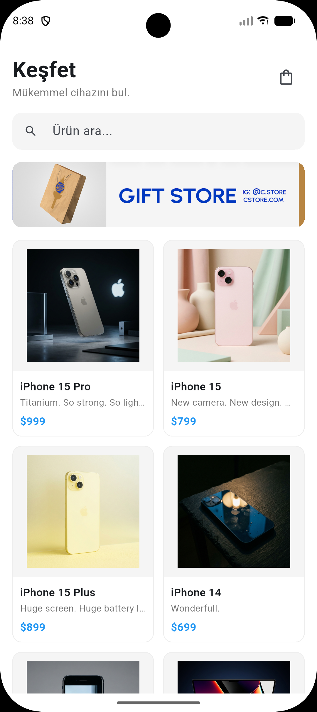
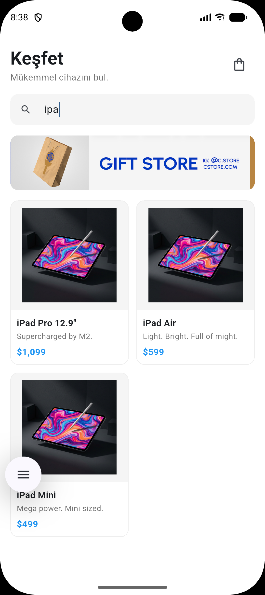
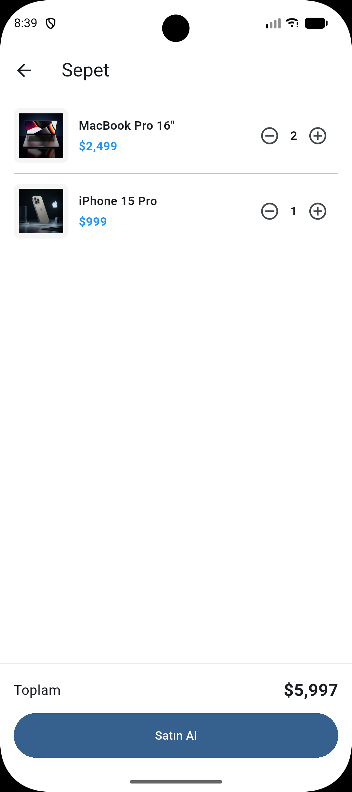
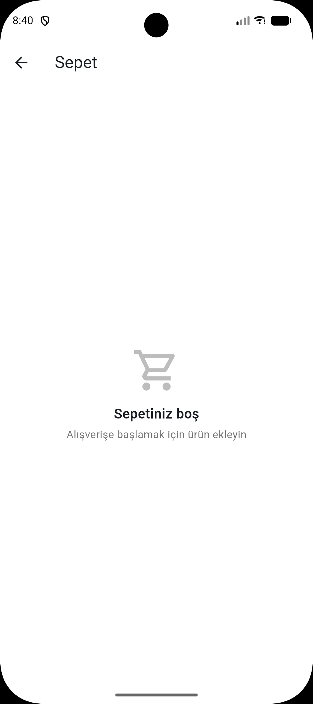

# Mini Katalog

Flutter ile geliştirilmiş basit bir ürün katalog uygulaması. Ürünleri liste hâlinde gösterir, arama yapmayı, ürün detayını görmeyi ve ürünleri sepete eklemeyi sağlar.

Flutter eğitimi proje çıktısı olarak hazırlanmıştır.

## Kullanılan Flutter Sürümü

- Flutter 3.44.4 (stable)
- Ekstra paket kullanılmamıştır, yalnızca `material.dart` kullanılmıştır.

## Özellikler

- Ana sayfada banner ve `GridView` ile ürün kartları
- Ürün adına ve sloganına göre arama
- Ürün detay sayfası (açıklama ve özellikler)
- Named routes ve route arguments ile sayfalar arası veri taşıma
- Sepete ekleme, adet artırma ve azaltma, toplam tutar hesabı
- Boş sepet ekranı
- Sepetteki ürün adedini gösteren rozet

## Veri Kaynağı

Ürün verileri ve görseller eğitim amaçlı `https://wantapi.com/products.php` adresinden alınmıştır. İnternet bağlantısı gerekmemesi için JSON dosyası ve görseller `assets/` klasörüne kaydedilmiş, uygulama bunları `rootBundle` ve `Image.asset` ile okumaktadır.

## Klasör Yapısı

```
lib/
  data/       JSON dosyasını okuyan kod
  models/     Product ve sepet modelleri
  screens/    Ana sayfa, ürün detayı, sepet
  utils/      Fiyat biçimlendirme
  widgets/    Ürün kartı
  routes.dart Rota adları
  main.dart
assets/
  data/       products.json
  images/     Ürün görselleri ve banner
screenshots/  Uygulama ekran görüntüleri
```

## Çalıştırma Adımları

1. Flutter SDK 3.44.4 ve Android Studio (emülatör için) kurulu olmalıdır.
2. Projeyi klonlayın:
```
   git clone https://github.com/silakozik/mini_katalog.git
   cd mini_katalog
```
3. Bağımlılıkları yükleyin:
```
   flutter pub get
```
4. Bir Android emülatörü başlatın veya Android cihaz bağlayın, ardından çalıştırın:
```
   flutter run
```

## Ekran Görüntüleri

| Ana Sayfa | Arama |
|---|---|
|  |  |

| Ürün Detayı | Sepet | Boş Sepet |
|---|---|---|
|  |  |  |